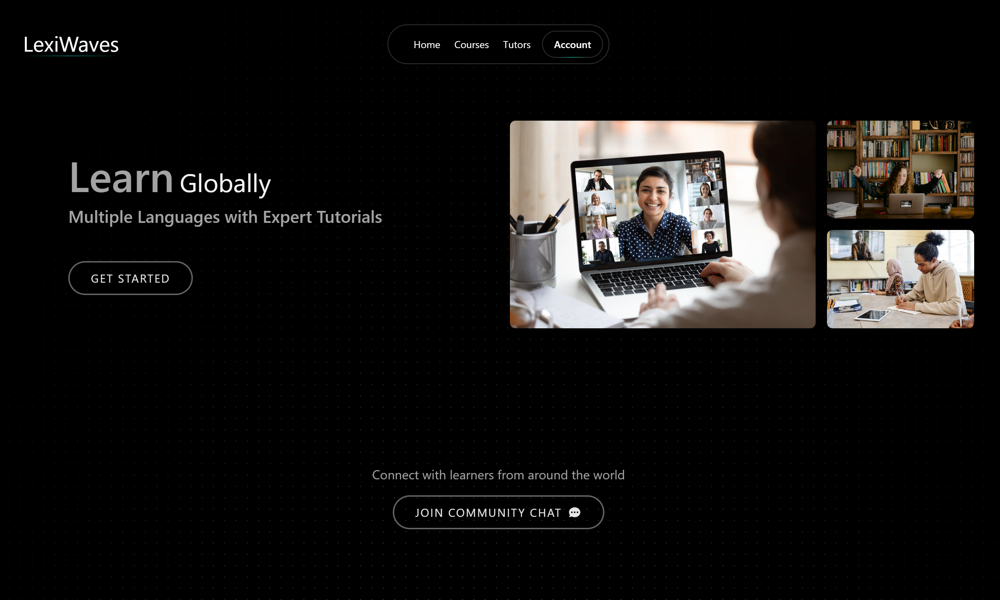

# LexiWaves - Online Language Learning Platform

[](https://sonarcloud.io/summary/new_code?id=shinas07_LexiWaves)
[](https://sonarcloud.io/summary/new_code?id=shinas07_LexiWaves)
[](https://sonarcloud.io/summary/new_code?id=shinas07_LexiWaves)
[](https://sonarcloud.io/summary/new_code?id=shinas07_LexiWaves)



## 📚 Overview

LexiWaves is an innovative online language learning platform that bridges the gap between learners and expert tutors. Our platform facilitates interactive learning experiences through live sessions, comprehensive courses, and a supportive community environment.

## 🌟 Key Features

### For Learners
- **Interactive Learning**
  - One-on-one sessions with expert tutors
  - Community chat for collaborative learning
  - Progress tracking and assessments
  - Downloadable achievement certificates

### For Tutors
- **Course Management**
  - Create and customize course content
  - Track student progress and engagement
  - Revenue sharing model
  - Performance analytics dashboard

### Administrative Features
- **Platform Management**
  - Course approval workflow
  - User management system
  - Revenue tracking and distribution
  - Quality assurance monitoring

## 🛠 Tech Stack

### Backend
- Django 4.x with REST Framework
- PostgreSQL for database
- Redis for caching
- Celery for task management
- AWS S3 for storage

### Frontend
- React 18 with Redux Toolkit
- Tailwind CSS for styling
- Axios for API communication
- WebSocket for real-time features

### DevOps & Infrastructure
- Docker containerization
- GitHub Actions for CI/CD
- AWS cloud infrastructure
- SonarCloud for code quality

## 🚀 Getting Started

### Prerequisites
```bash
# Required installations
- Python 3.10+
- Node.js 16+
- PostgreSQL
- Redis
- Docker 
```

### Development Setup

1. **Clone Repository**
```bash
git clone https://github.com/shinas07/LexiWaves 
cd LexiWaves
```

2. **Backend Setup**
```bash
cd server
python -m venv venv
source venv/bin/activate  # Linux/Mac
venv\Scripts\activate     # Windows
pip install -r requirements.txt
python manage.py migrate
python manage.py runserver
```

3. **Frontend Setup**
```bash
cd client
npm install
npm run dev
```

## 📁 Project Structure

```
LexiWaves/
├── client/                 # Frontend React application
│   ├── src/
│   │   ├── components/    # Reusable UI components
│   │   ├── pages/        # Page components
│   │   ├── services/     # API services
│   │   └── store/        # Redux store
│   └── public/           # Static assets
├── server/                           # Backend Django application
│   ├── apps/
│   │   ├── accounts/                 # User authentication
│   │   ├── classchat/                # Class chat functionality
│   │   ├── community_chat/           # Community chat functionality
│   │   ├── lexit_admin/              # Admin panel for Lexit
│   │   ├── student/                  # Student-specific features
│   │   ├── tutor/                    # Tutor-specific features
│   │   └── video_call/               # Video call functionality
│   └── config/                       # Project configuration (settings, urls, wsgi, etc.)
├── docker/                           # Docker-related files
├── pytest.ini                        # Pytest configuration file
└── Dockerfile                        # Dockerfile for the backend container
```

```
LexiWaves/
├── client/                 # Frontend React application
│   ├── src/
│   │   ├── components/    # Reusable UI components
│   │   ├── pages/        # Page components
│   │   ├── services/     # API services
│   │   └── store/        # Redux store
│   └── public/           # Static assets
├── server/                # Backend Django application
│   ├── apps/
│   │   ├── courses/      # Course management
│   │   ├── users/        # User authentication
│   │   └── payments/     # Payment processing
│   └── config/           # Project configuration
└── docker/               # Docker configuration
```

## 🔒 Security Features

- JWT authentication
- CORS protection
- Request rate limiting
- Input validation

## 🌐 API Features

- RESTful architecture
- Comprehensive documentation
- Rate limiting
- Token-based authentication

## 📊 Monitoring & Analytics

- SonarCloud integration
- Error tracking
- User analytics

## 🤝 Community and Support

- Detailed documentation
- Issue tracking
- Community guidelines
- Support channels

## 📫 Contact

For questions or support, please reach out:
- Email: shinasaman07@gmail.com
- Website: [www.lexiwaves.com](https://www.lexiwaves.com)

🙌 Acknowledgments
Made with ❤️ by shinas
